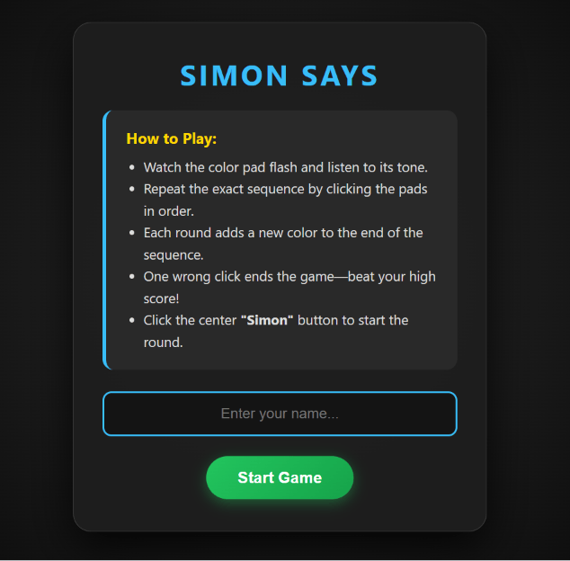
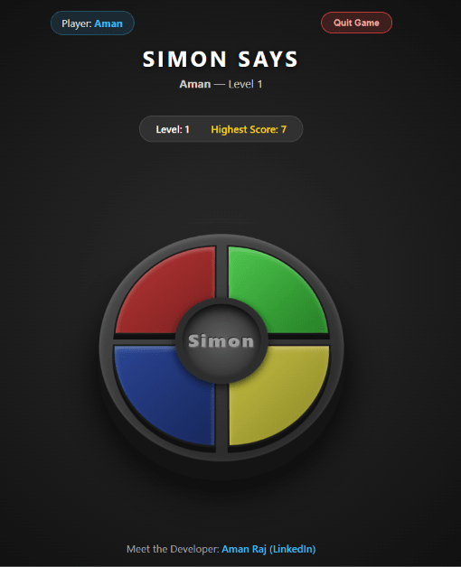

<<<<<<< HEAD
# 🎮 Simon Says — 3D Arcade Memory Game

An interactive, retro-inspired **Simon Says** memory game built with vanilla **HTML5, CSS3, and JavaScript**. Designed with a 3D arcade console aesthetic, real-time synthesized sound effects, player personalization, and persistent high-score tracking.

🔗 **[Play the Live Game Here](https://amanraj7782.github.io/simon-says-game/)**

---

## ✨ Key Features

* **🕹️ 3D Arcade Console UI:** Styled with CSS3 perspective transforms, gradients, and glowing pad animations to replicate the classic tabletop Simon console.
* **🔊 Dynamic Web Audio Synthesizer:** Zero external `.mp3` dependencies—uses the browser's native **Web Audio API** to generate distinct musical frequencies for each color pad (`E4`, `C4`, `A3`, `G4`), level-up chimes, and a game-over buzzer.
* **👤 Player Personalization:** Welcomes players with an instruction overlay and custom name entry displayed throughout the session.
* **🏆 Persistent High Score:** Automatically saves and updates your all-time highest score in the browser using `localStorage`.
* **📱 Fully Responsive:** Scales cleanly across desktop monitors, tablets, and mobile screens.
* **🚪 Instant Quit & Summary Screen:** Allows players to exit at any time with a final score summary and developer profile link.

---

## 📸 Screenshots

> **Note:** Create a folder named `screenshots` in your project and save your images there (see instructions below).

### Start & Instructions Screen


### 3D Game Console Interface


---

## 🧠 How to Play

1. **Enter Your Name:** Type your name on the welcome screen and click **Start Game**.
2. **Start the Round:** Click the center **Simon** hub, press any key on your keyboard, or tap any color pad to begin **Level 1**.
3. **Watch & Listen:** Pay close attention as the game flashes a color pad and plays its unique musical tone.
4. **Repeat the Sequence:** Click the exact same color pad. 
5. **Advance Levels:** Each level adds a new random color to the end of the sequence. Repeat the **entire sequence from the beginning** in the exact order!
6. **Game Over:** Clicking the wrong pad flashes the screen red, sounds the buzzer, and records your highest score. Press any key or tap any pad to play again, or click **Quit Game** to exit.

---

## 🛠️ Tech Stack

* **HTML5:** Semantic structure and overlay screens.
* **CSS3:** Flexbox, CSS Grid, 3D `perspective` transforms, radial gradients, and media queries.
* **JavaScript (ES6+):** DOM manipulation, event handling, state management, `localStorage`, and the **Web Audio API**.

---

## 📂 Project Structure

```text
simon-says-game/
├── index.html        # Game structure, start modal, and quit overlay
├── style.css         # 3D board styling, animations, and responsive layout
├── app.js            # Game sequence logic, Web Audio synth, and score tracking
├── screenshots/      # Game preview images for README
└── README.md         # Project documentation
=======
# simon-says-game
a traditional children's party and movement game for three or more players where one person acts as the leader ("Simon") and issues physical commands
>>>>>>> 042062d0aba70dcde34cc200992a979631efd15f
